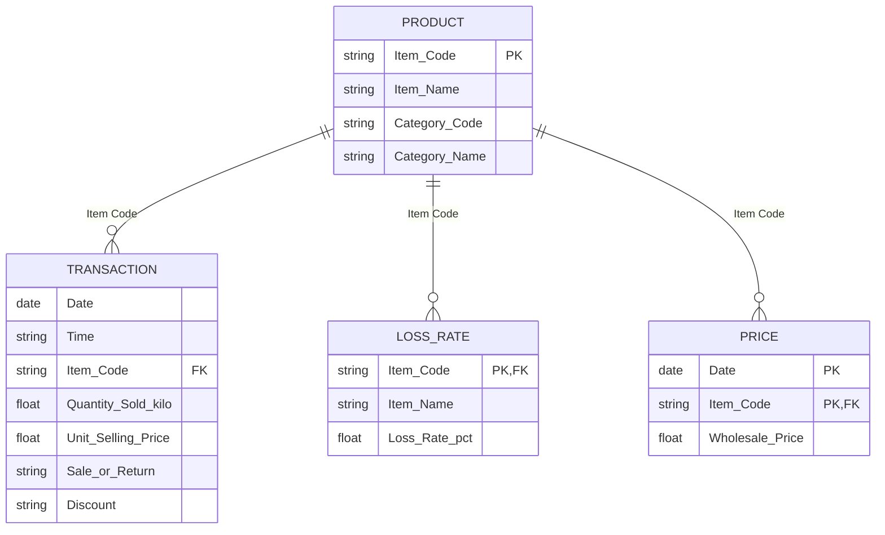

# Rendu Data Analytics - Exercices de rattrapage

Ce dépôt contient le travail de rattrapage pour les 3 exercices demandés dans le cours.

---

## 1. Exercice 1 : Cadrage métier (5W) et Dictionnaire des données

Le détail complet de l'exercice 1 est disponible dans le dossier `docs/` :  
👉 **[Document complet de l'Exercice 1](docs/EXERCICE_1_CADRAGE_5W_ET_DICTIONNAIRE.md)**

### Résumé des 5W :
* **Why (Pourquoi) :** Comprendre pourquoi les ventes de produits frais baissent sur certaines catégories et trouver où agir pour redresser la situation.
* **Who (Qui) :** Le Comex et les directeurs de catégories du rayon frais.
* **What (Quoi) :** Un dashboard Power BI et une analyse des indicateurs clés (Chiffre d'affaires, volume en kg, marge brute, casse en RMB/euros, taux de remise).
* **Where (Où) :** Les données viennent de 4 fichiers : `transaction.csv`, `product.csv`, `price.csv` et `loss_rate.csv`.
* **When (Quand) :** Comparaison entre la période actuelle (Juillet 2022 à Juin 2023) et l'année précédente (Juillet 2021 à Juin 2022).

---

## 2. Exercice 2 : Nettoyage des 4 fichiers et modèle de données

Pour préparer les données, j'ai nettoyé les 4 fichiers CSV :

| Fichier | Nettoyages effectués | Justification métier |
| :--- | :--- | :--- |
| `transaction.csv` | Déduction des retours clients (quantité négative), formatage des dates et du statut remise. | Si on ne retire pas les retours, le chiffre d'affaires et les volumes réels sont faussés. |
| `product.csv` | Suppression des espaces insécables (`\xa0`) et nettoyage des textes. | Un espace spécial séparait la catégorie "Flower/Leaf Vegetables" en deux. |
| `price.csv` | Vérification du format de date `YYYY-MM-DD` et validation des prix grossistes positifs. | Avoir des coûts d'achats exacts pour calculer la marge brute au jour le jour. |
| `loss_rate.csv` | Suppression du caractère spécial UTF-8 BOM (`\ufeff`) dans le titre de colonne et conversion des pourcentages en décimales. | Le caractère spécial empêchait de faire les jointures avec la table produit. |

### Relations entre les tables brutes (Modèle relationnel) :
Toutes les tables brutes sont reliées via le code produit (`Item Code`) et la date :



### Modèle de données cible (Schéma en étoile) :
Pour alimenter proprement le dashboard, les données nettoyées ont été consolidées dans un **schéma en étoile (Gold)** :

```mermaid
graph TD
    D1[dim_calendar<br>date, mois, trimestre, période]
    D2[dim_categories<br>code_catégorie, nom_catégorie]
    D3[dim_products<br>code_produit, nom_produit]
    D4[dim_loss_rate<br>code_produit, taux_de_perte]

    F[fact_daily_category_sales<br>-----------------------------<br>date (FK)<br>category_name (FK)<br>CA Net (RMB)<br>Volume (kg)<br>Coût d'achat (COGS)<br>Marge brute<br>Coût de la casse<br>Marge nette]

    D1 --> F
    D2 --> F
    D3 -.-> F
    D4 -.-> F
```

* **Table de faits :** `fact_daily_category_sales.csv` (contient les ventes journalières par catégorie : CA net, volume, coût d'achat, casse et marges).
* **Tables de dimensions :**
  * `dim_products.csv` : liste des 251 produits.
  * `dim_categories.csv` : les 6 catégories de légumes.
  * `dim_calendar.csv` : calendrier avec les dates, mois, trimestres et périodes (N vs N-1).
  * `dim_loss_rate.csv` : taux de casse par produit.

---

## 3. Exercice 3 : Dashboard de restitution

Le dashboard a été réalisé dans un style Power BI simple, centré sur les chiffres et sans texte inutile :  
👉 **[Ouvrir le Dashboard](dashboard/index.html)** *(à ouvrir dans un navigateur web)*

### Ce qu'on observe au premier coup d'œil :
1. **Une catégorie est en crise :** La catégorie **Solanum (aubergines)** s'effondre avec **-31.5% de CA** et **-30.8% de volume**. La référence phare *Changxianqie* a plongé de -71.8%, notamment car il n'y a eu aucune promotion (0.2% de taux promo).
2. **Une grosse perte sur la casse :** **63 040 RMB** de marchandise jetée au total sur l'année, dont **34%** rien que sur les légumes feuilles (salades/choux).
3. **Le reste du rayon se porte bien :** Les 5 autres catégories progressent, notamment les poivrons (+22% de CA) et les champignons (+43% de CA).

---

## 4. Organisation des branches Git

Conformément aux consignes du projet :
* `feature/clean-transaction` : code de nettoyage du fichier transaction.
* `feature/clean-product` : code de nettoyage du référentiel produit.
* `feature/clean-price` : code de nettoyage des prix grossistes.
* `feature/clean-loss-rate` : code de nettoyage des taux de casse.
* `develop` : branche d'intégration où les 4 branches ont été fusionnées pour tester le pipeline complet.
* `main` : branche finale propre pour la livraison.

---

## 5. Comment exécuter le code

Pour relancer le nettoyage et générer les tables :
```bash
python src/pipeline.py
```

Pour lancer les tests unitaires :
```bash
python -m unittest tests/test_cleaning.py
```
