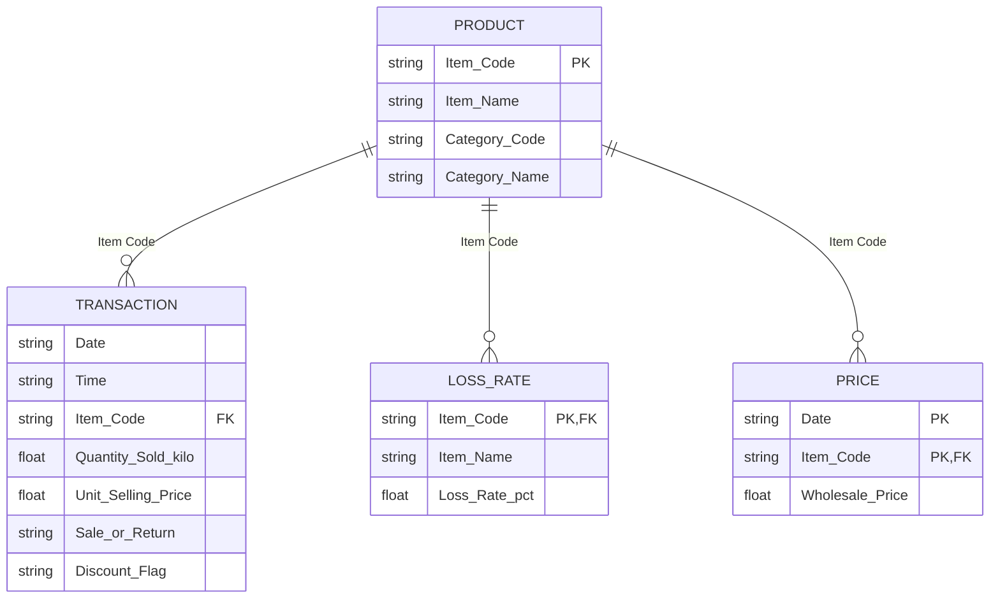
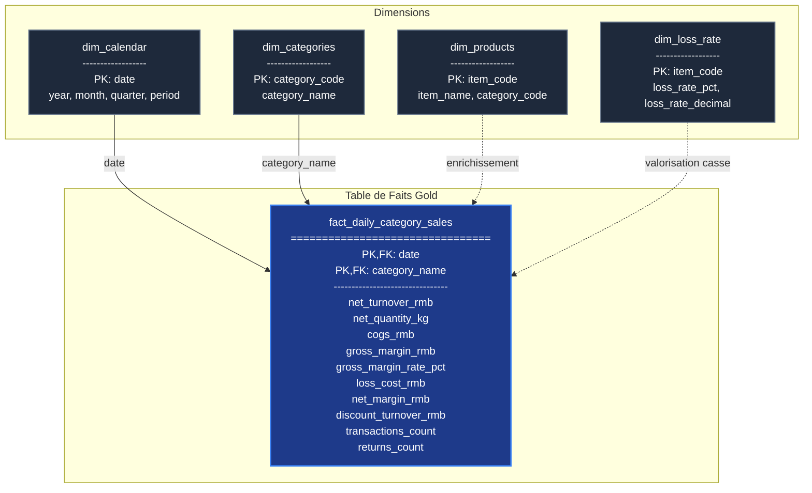

# 🛒 Projet Data Analytics & Engineering — Restitution Rayon Produits Frais

[](https://github.com)
[](https://www.python.org/)
[](LICENSE)

Ce dépôt contient l'ensemble des livrables de cadrage, de nettoyage, de modélisation et de restitution pour le projet **Data Analytics — Performance Rayon Frais**.

---

## 📑 Sommaire
1. [Contexte Métier & Enjeux (Exercice 1)](#1-contexte-métier--enjeux-exercice-1)
2. [Étape 1 : Le Diagnostic & La Spécialisation des Rôles](#2-étape-1--le-diagnostic--la-spécialisation-des-rôles)
3. [Étape 2 : Modèle Relationnel & Schéma en Étoile (Gold Layer)](#3-étape-2--modèle-relationnel--schéma-en-étoile-gold-layer)
4. [Étape 3 : Pipeline de Nettoyage & Consolidation](#4-étape-3--pipeline-de-nettoyage--consolidation)
5. [Étape 4 : Stratégie Git d'Équipe & Workflow CI/CD](#5-étape-4--stratégie-git-déquipe--workflow-cicd)
6. [Restitution Comex : Dashboard & Slides (Exercice 3)](#6-restitution-comex--dashboard--slides-exercice-3)
7. [Guide de Démarrage Rapide](#7-guide-de-démarrage-rapide)

---

## 1. Contexte Métier & Enjeux (Exercice 1)

> **Message Slack Urgent du Manager :**  
> *« Salut ! Le Comex trouve que nos ventes des produits frais ne performent pas assez sur certaines catégories. Il me faudrait un truc clair pour demain matin sur ce qui bloque, histoire qu'on sache où agir. Merci ! »*

Le document complet de cadrage (5W, Dictionnaire de données, Pièges et Maquette décisionnelle) est disponible dans [`docs/EXERCICE_1_CADRAGE_5W_ET_DICTIONNAIRE.md`](docs/EXERCICE_1_CADRAGE_5W_ET_DICTIONNAIRE.md).

### Synthèse des 5W
* **Why ?** Identifier les catégories qui sous-performent (effondrement de volumes, marges faibles, casse excessive) et donner au Comex des leviers d'action immédiats.
* **Who ?** Comité Exécutif (Comex), Direction Générale et Category Managers Frais.
* **What ?** Rapport de diagnostic, Dashboard exécutif, KPIs consolidés (CA, Marge, Volume, Casse, Remises, Évolutions vs N-1).
* **Where ?** 4 tables sources (`transaction.csv`, `product.csv`, `price.csv`, `loss_rate.csv`).
* **When ?** Période N (Juillet 2022 - Juin 2023) comparée à N-1 (Juillet 2021 - Juin 2022).

---

## 2. Étape 1 : Le Diagnostic & La Spécialisation des Rôles

Une équipe de 4 Data Analysts / Analytics Engineers s'est répartie la responsabilité des 4 tables sources :

| Rôle | Membre Responsable | Fichier Source | Anomalies & Nettoyages Identifiés | Justification Métier |
| :--- | :--- | :--- | :--- | :--- |
| **Membre 1** | Analyste POS / Encaissements | `transaction.csv` (et `transaction (1).csv`) | 1. Présence de 461 transactions de retour (`'return'`).<br>2. Flags remises textuels (`'Discount (Yes/No)'`).<br>3. Horodatage milliseconde vs date journalière. | Les retours doivent être **déduits du CA et du volume** (`net_quantity = -abs(qty)`), sous peine de gonfler artificiellement les ventes réelles. |
| **Membre 2** | Analyste Référentiel Produits | `product.csv` | 1. Espaces insécables (`\xa0`) dans `'Flower/Leaf\xa0Vegetables'`.<br>2. Espaces superflus (trimming).<br>3. Typage de l'identifiant article en chaîne de caractères. | L'espace insécable sépare artificiellement la catégorie principale en deux lors des filtres et jointures. |
| **Membre 3** | Analyste Pricing / Achats | `price.csv` | 1. Formatage des dates en ISO `YYYY-MM-DD`.<br>2. Validation des prix grossistes positifs (> 0).<br>3. Déduplication sur la clé composite `(Date, Item Code)`. | Garantir que le coût d'achat (COGS) journalier s'aligne fidèlement sur le cours réel de la mercuriale grossiste. |
| **Membre 4** | Analyste Démarque & Pertes | `loss_rate.csv` | 1. En-tête corrompu par un BOM UTF-8 (`\ufeffItem Code`).<br>2. Taux de perte en texte avec espaces (ex: `'4.39 '`).<br>3. Conversion en taux décimal (0.0439). | Sans suppression du BOM, les jointures sur `Item Code` échouent. Le taux doit être valorisé financièrement en RMB de perte pour le magasin. |

---

## 3. Étape 2 : Modèle Relationnel & Schéma en Étoile (Gold Layer)

### A. Modèle de Données Relationnel Source (Bronze / Silver)



### B. Modèle Cible en Étoile (Gold Layer)

Pour optimiser les performances de requêtage décisionnel et alimenter le Dashboard, nous avons modélisé une **Table de Faits centrale** entourée de **4 Tables de Dimensions** :



---

## 4. Étape 3 : Pipeline de Nettoyage & Consolidation

Le code a été découpé de manière modulaire dans le dossier `src/` :
- `src/clean_product.py` : Nettoie et valide les 251 références produits et extrait les catégories.
- `src/clean_loss_rate.py` : Décode le BOM UTF-8, convertit les pourcentages en décimaux et valide les bornes.
- `src/clean_price.py` : Normalise les dates et les cours grossistes journaliers.
- `src/clean_transaction.py` : Nettoie en flux mémoire (streaming) les 878 503 transactions, déduit les retours et applique le flag promo.
- `src/pipeline.py` : Consolide les sources, produit le schéma en étoile Gold et génère les indicateurs Comex.

### Formules Métier Appliquées
$$\text{CA Net} = \text{Quantité Nette (kg)} \times \text{Prix Vente Unitaire (RMB/kg)}$$
$$\text{COGS} = \text{Quantité Nette (kg)} \times \text{Prix Grossiste (RMB/kg)}$$
$$\text{Marge Brute} = \text{CA Net} - \text{COGS}$$
$$\text{Coût de la Casse} = \text{Quantité Nette (kg)} \times \text{Taux de Perte} \times \text{Prix Grossiste (RMB/kg)}$$
$$\text{Marge Nette Réelle} = \text{Marge Brute} - \text{Coût de la Casse}$$

---

## 5. Étape 4 : Stratégie Git d'Équipe & Workflow CI/CD

Conformément à la Slide 38, la stratégie Git collaborative évite les conflits grâce au modèle de branches :

```
main (Production finale & validée)
  │
  └── develop (Intégration et validation collective)
        │
        ├── feature/clean-transaction   (Membre 1)
        ├── feature/clean-product       (Membre 2)
        ├── feature/clean-price         (Membre 3)
        └── feature/clean-loss-rate     (Membre 4)
```

1. **4 Branches Feature dédiées :** Chaque membre développe et commite ses tests de manière isolée.
2. **Branche d'intégration `develop` :** Fusion des 4 branches pour exécuter le pipeline de bout en bout.
3. **Branche de production `main` :** Version finale prête pour le déploiement et la livraison au Comex.
4. **Pipeline CI/CD GitHub Actions (`.github/workflows/ci.yml`) :** Automatise l'exécution des tests unitaires (`pytest` / `unittest`), le linting (`flake8`) et la vérification du formatage (`black`).

---

## 6. Restitution Comex : Dashboard & Slides (Exercice 3)

Deux formats de restitution professionnels ont été développés pour répondre à la problématique :

### 1. Le Dashboard Exécutif Interactif (`dashboard/index.html`)
- **4 KPI Cards :** CA Net (1.15M RMB, +24.2%), Volume (191.9t, +66.3%), Marge Nette (383.8k RMB, tx 33.2%), Coût Casse (63.0k RMB, 5.5% du CA).
- **Graphique décisionnel en 3 secondes :** Identification immédiate du blocage critique sur les **Solanum (-31.5% CA)** et de l'hémorragie de casse sur **Flower/Leaf (21.5k RMB)**.
- **Top 5 articles en casse :** Broccoli, Xixia Mushroom, Yunnan Lettuce, etc.

### 2. Le Slide Deck Exécutif Comex (`presentation/slides_comex.html`)
- 6 slides percutantes sans bruit inutile (navigables au clavier et prêtes pour l'impression / export PDF).
- **Plan d'Action Actionnable en 3 décisions immédiates :**
  1. *Relance commerciale Solanum :* Activer les promotions (actuellement à 0.2%) et repositionner le prix du Changxianqie (-71.8%).
  2. *Plan anti-casse Feuilles :* Cadencement des approvisionnements à J-1 et déstockage du soir à -30%.
  3. *Optimisation du mix prix :* Relèvement de +3% à +5% sur les poivrons et champignons à forte rotation.

---

## 7. Guide de Démarrage Rapide

### Exécution des Tests
```bash
python -m unittest tests/test_cleaning.py
```

### Exécution du Pipeline ETL
```bash
python src/pipeline.py
```

### Visualisation du Dashboard & des Slides
- Ouvrez simplement `dashboard/index.html` dans votre navigateur web.
- Ouvrez `presentation/slides_comex.html` pour lancer la présentation Comex.
